<!-- Fuente editable completa Quarto · 21 láminas. Lámina 2 contextualiza con PISA 2025/2022 sin comparación temporal; la tesis analiza solo PISA 2022. Las láminas 16 y 17 explican por separado ANXMAT y ESCS; la 18 distingue niveles y centrado; sin ecuación visible. -->

## ¿La ansiedad matemática se relaciona de la misma manera con el rendimiento en todas las escuelas? {#slide_01}

Ansiedad matemática y rendimiento: ¿cambia su asociación entre escuelas?

Heterogeneidad y composición socioeconómica escolar en 13 sistemas educativos de América Latina y el Caribe

<strong>Katherine Aravena Herrera</strong>Universidad de Chile · Magíster en Psicología EducacionalProfesora guía: Lorena Ortega · Profesora del seminario: Natalia Albornoz

Título oficial: Heterogeneidad de la asociación entre ansiedad matemática y rendimiento matemático según la composición socioeconómica escolar en 13 sistemas educativos de América Latina y el Caribe: Evidencia de PISA 2022

<aside class="notes">Los resultados de matemáticas muestran un desafío educativo relevante. Pero mirar solamente el desempeño no permite comprender cómo los estudiantes experimentan las matemáticas. Este proyecto se interesa por esa dimensión psicológica y por los contextos escolares en los que ocurre.</aside>

## En la región persiste un amplio desafío de desempeño matemático {#slide_02}

RELEVANCIA EDUCATIVA · PISA 2025 · 0:30

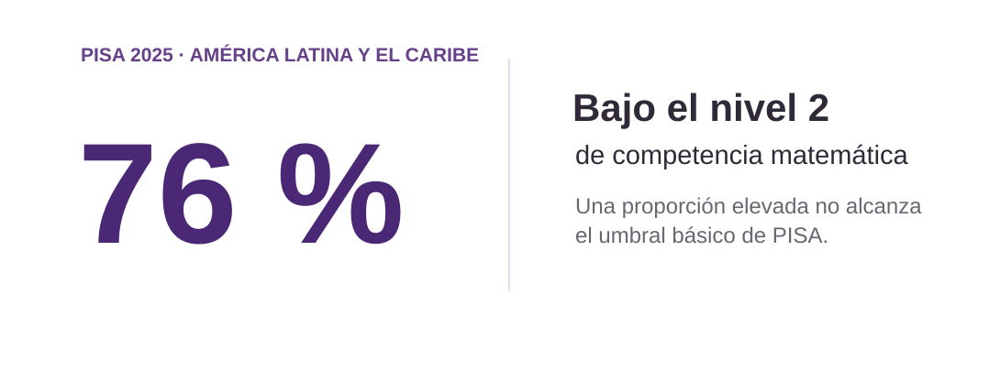

BID (2026), resultados de PISA 2025 · Indicador regional publicado, no muestra de tesis

<aside class="notes">En PISA 2025, el BID informa que el 76 % de los estudiantes de América Latina y el Caribe se situó bajo el nivel 2 de competencia matemática. Es un indicador regional, no un resultado de nuestra muestra. Los puntajes revelan un problema educativo relevante, pero no describen por sí solos cómo los estudiantes experimentan las matemáticas.</aside>

## La ansiedad matemática es relevante en Chile y la región {#slide_03}

EL FENÓMENO PSICOLÓGICO · 0:40

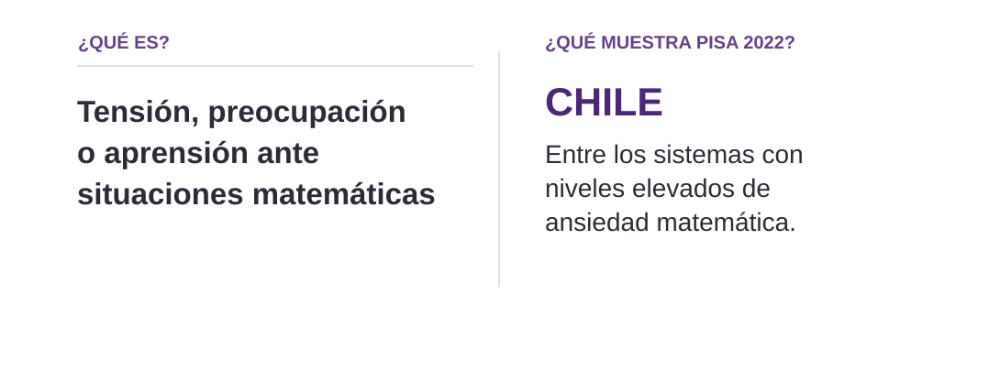

Ashcraft (2002); OECD (2024), PISA 2022, vol. V; UNESCO (2024)

<aside class="notes">La ansiedad matemática se refiere a tensión, preocupación o aprensión ante situaciones que implican matemáticas. PISA 2022 identifica a Chile y otros sistemas de la región, como Argentina, Brasil y México, entre aquellos con niveles elevados de ansiedad matemática. Esto muestra que la problemática no se limita al desempeño: también hay una experiencia emocional que merece atención desde la psicología educacional. ¿Qué sabemos de su relación con los resultados matemáticos?</aside>

## La evidencia acumulada muestra una asociación negativa con el rendimiento {#slide_04}

EVIDENCIA EMPÍRICA · METAANÁLISIS · 0:35

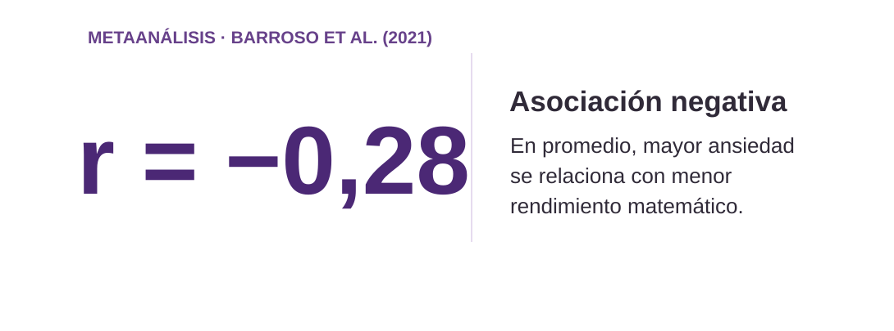

Barroso et al. (2021), 223 estudios y 747 tamaños de efecto; IC 95 % [−0,29; −0,26]

<aside class="notes">Barroso y colaboradores sintetizaron 223 estudios y estimaron una correlación promedio de menos 0,28 entre ansiedad matemática y rendimiento. En general, quienes reportan mayor ansiedad tienden a mostrar menor rendimiento. Es una asociación de magnitud pequeña a moderada, que no demuestra causalidad. Para comprender esta experiencia psicológica recurrimos a la Teoría de Control-Valor.</aside>

## El control y el valor ayudan a comprender la ansiedad matemática {#slide_05}

PSICOLOGÍA EDUCACIONAL · TEORÍA DE CONTROL-VALOR · 0:55

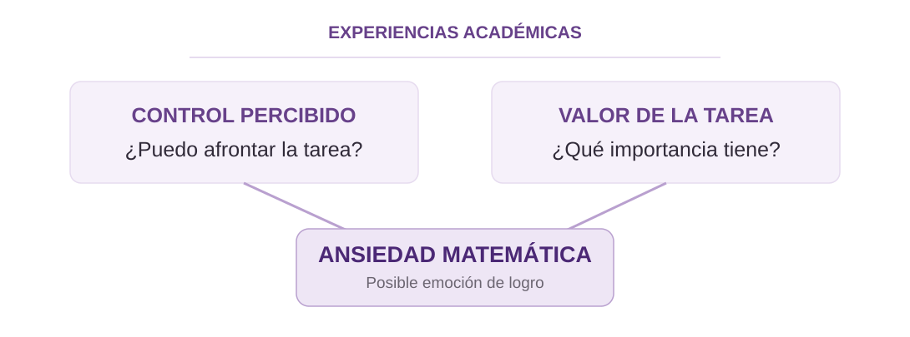

Pekrun (2006, 2024) · Esquema teórico conceptual

<aside class="notes">La Teoría de Control-Valor de Pekrun ayuda a interpretar las emociones asociadas con actividades y resultados académicos. Dos valoraciones son relevantes. El control percibido es cuánto cree una persona que puede afrontar una tarea o influir en su resultado. El valor expresa cuánto le importa esa tarea. La ansiedad puede resultar plausible cuando una actividad importa, pero el control se percibe incierto o limitado. Estas valoraciones se sitúan en experiencias educativas como la enseñanza, la evaluación y la retroalimentación. La teoría es un marco interpretativo en la tesis: no estamos estimando una mediación de control y valor. La posibilidad de diferencias de asociación entre escuelas requiere evidencia adicional.</aside>

## La intensidad de la asociación puede variar entre escuelas {#slide_06}

HETEROGENEIDAD ENTRE ESCUELAS · 0:45

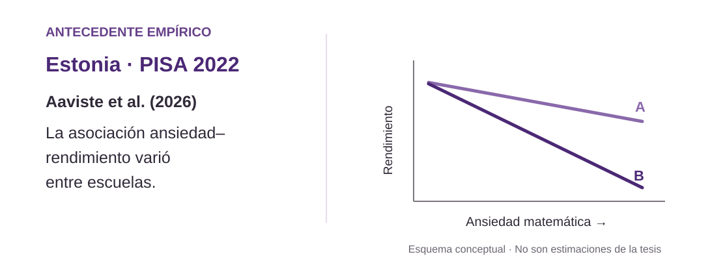

Aaviste et al. (2026), PISA 2022 de Estonia · Pendientes ilustrativas

<aside class="notes">Una asociación promedio no significa que el vínculo tenga la misma intensidad en todas las escuelas. Aaviste y colegas analizaron 6.232 estudiantes de 166 escuelas de Estonia con PISA 2022 y documentaron variación entre escuelas en esa asociación. Las pendientes que vemos son ilustrativas, no estimaciones de esta tesis. Si esta relación puede variar, surge una pregunta: ¿esas diferencias guardan algún patrón asociado con características de los establecimientos? Una dimensión pertinente para examinar es la composición socioeconómica escolar.</aside>

## La composición socioeconómica es una dimensión relevante del contexto escolar {#slide_07}

DIMENSIÓN SOCIOEDUCATIVA · COMPOSICIÓN · 0:40

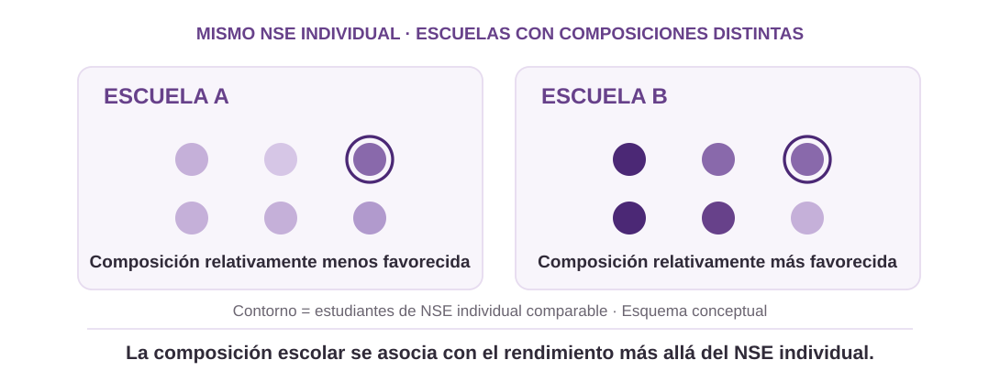

Perry y McConney (2010); proyecto de tesis, §2.5 · Esquema conceptual

<aside class="notes">Si la asociación entre ansiedad y rendimiento varía entre escuelas, es razonable explorar características de esos contextos. La composición resume el perfil socioeconómico de quienes asisten a un establecimiento, sin equivaler a sus recursos o prácticas. La literatura muestra asociaciones entre composición y rendimiento más allá del nivel socioeconómico individual, pero eso no demuestra una moderación de la pendiente.

Desde la Teoría de Control-Valor, experiencias de apoyo, dificultad o exigencia podrían relacionarse con el control percibido y con la manera en que ansiedad y desempeño se asocian. Son rutas posibles, no mecanismos medidos aquí. Ahora veamos la distribución social entre escuelas.</aside>

## La distribución socioeconómica entre escuelas hace pertinente comparar sistemas {#slide_08}

PERTINENCIA REGIONAL · PISA 2022 · 0:40

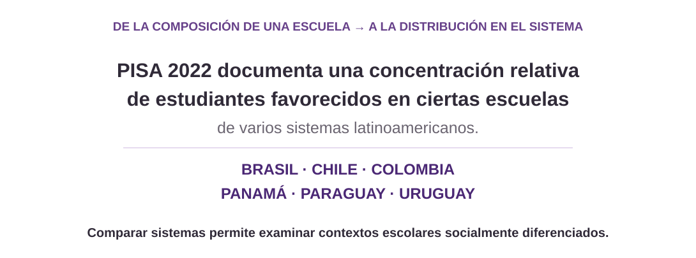

OECD (2023), PISA 2022 Results, vol. II, figura II.4.13 · Países ilustrativos

<aside class="notes">En PISA 2022, la OCDE documentó que los estudiantes favorecidos estaban relativamente más concentrados que los desfavorecidos en determinadas escuelas de varios sistemas latinoamericanos. Los seis países mostrados son ejemplos, no un ranking. Antes describimos el perfil social de una escuela; ahora observamos cómo los grupos se distribuyen entre establecimientos de un sistema. Como esas configuraciones no son idénticas, comparar sistemas es pertinente. Esta evidencia, sin embargo, no demuestra que la composición modere el vínculo ansiedad–rendimiento. Esa relación específica permanece abierta.</aside>

## La relación entre composición escolar e intensidad de la asociación sigue abierta {#slide_09}

BRECHA CIENTÍFICA · CONTRIBUCIÓN · 0:35

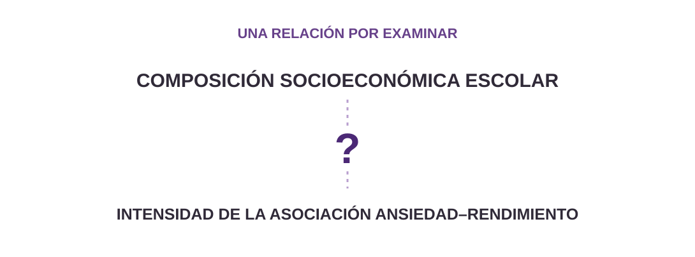

Síntesis del proyecto de tesis, secciones 1.3 y 2.6

<aside class="notes">Sabemos que la asociación ansiedad–rendimiento puede variar entre escuelas y que la composición socioeconómica se relaciona con resultados educativos. Pero eso no prueba que modere la pendiente.

Desde Control-Valor hay rutas posibles: apoyo y oportunidades podrían acompañar pendientes menos negativas; exigencias, comparación social o dificultades, pendientes más negativas.

Ninguna se mide aquí y pueden coexistir. Por eso H3 no anticipa dirección: buscamos un patrón contextual observable, no identificar su mecanismo causal.</aside>

## Pregunta de investigación {#slide_10}

EL PROBLEMA · PREGUNTA FORMAL · 0:30

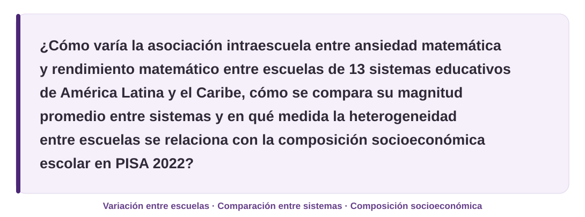

Proyecto de tesis, sección 3.1 · Formulación oficial íntegra

<aside class="notes">Esta pregunta articula la comparación de la asociación promedio entre sistemas, su posible variación entre escuelas y el papel de la composición socioeconómica escolar. Para responderla, organizamos la investigación en tres objetivos complementarios.</aside>

<!-- Texto oficial íntegro: ¿Cómo varía la asociación intraescuela entre ansiedad matemática y rendimiento matemático entre escuelas de 13 sistemas educativos de América Latina y el Caribe, cómo se compara su magnitud promedio entre sistemas y en qué medida la heterogeneidad entre escuelas se relaciona con la composición socioeconómica escolar en PISA 2022? -->

## Tres objetivos organizan la estrategia de investigación {#slide_11}

OBJETIVOS ESPECÍFICOS · 0:35

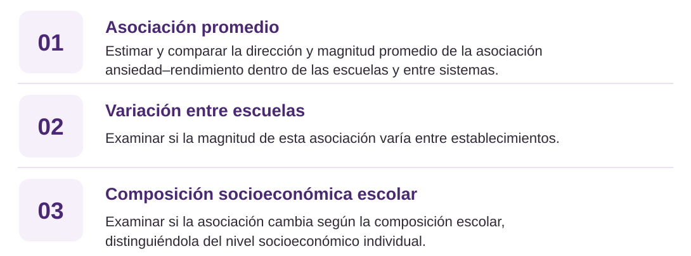

Proyecto de tesis, sección 3.3 · Síntesis visual de los objetivos oficiales

<aside class="notes">Para responder la pregunta, el estudio se organiza en tres objetivos. Primero, estimar y comparar la dirección y la magnitud promedio de la asociación intraescuela entre ansiedad matemática y rendimiento matemático en los sistemas considerados. Segundo, examinar cómo varía la magnitud de esa asociación entre escuelas. Y tercero, evaluar si dicha magnitud difiere según la composición socioeconómica escolar, distinguiendo esa dimensión contextual de la posición socioeconómica individual. Estos objetivos orientan las tres hipótesis.</aside>

<!-- Objetivos oficiales íntegros del proyecto de tesis:
1. Estimar y comparar la dirección y magnitud promedio de la asociación intraescuela entre ansiedad matemática y rendimiento matemático en los sistemas educativos considerados.
2. Examinar la variación entre escuelas en la magnitud de la asociación intraescuela entre ansiedad matemática y rendimiento matemático en los sistemas educativos considerados.
3. Examinar si la magnitud de la asociación intraescuela entre ansiedad matemática y rendimiento matemático difiere según la composición socioeconómica escolar, distinguiendo esta dimensión contextual de la posición socioeconómica individual de los estudiantes.
-->

## Tres hipótesis para examinar una misma relación {#slide_12}

PREGUNTA E HIPÓTESIS · 0:35

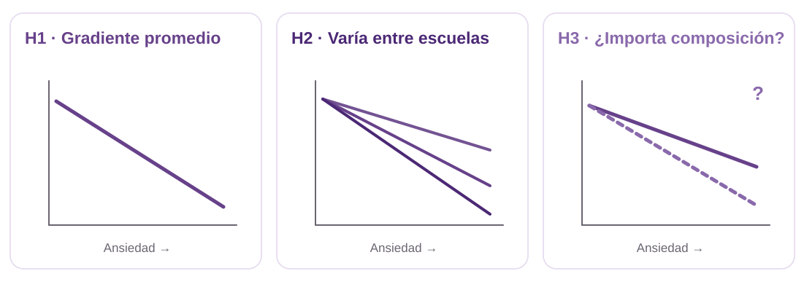

Hipótesis oficiales del proyecto, sección 3.4 · Diagramas conceptuales

<aside class="notes">Los objetivos dan lugar a tres hipótesis contrastables: esperamos una asociación intraescuela negativa, examinaremos la heterogeneidad de sus pendientes y evaluaremos una posible moderación por composición, sin anticipar su dirección. Para ponerlas a prueba, necesitamos definir el diseño y los datos.</aside>

## Estudio cuantitativo con datos secundarios de PISA 2022 {#slide_13}

MÉTODO / 01 · DISEÑO Y DATOS · 0:40

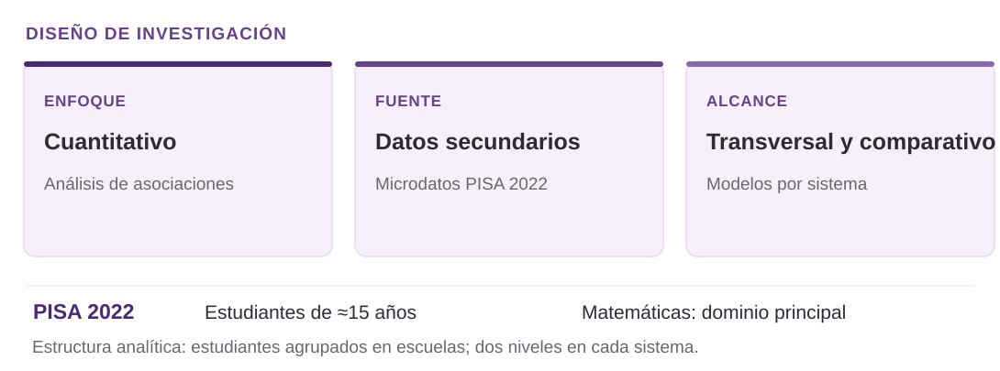

OECD (2024b); proyecto de tesis, §4.1

<aside class="notes">Este estudio es cuantitativo y analiza microdatos secundarios de PISA 2022. Es un diseño observacional, transversal y comparativo: no intervenimos ni identificamos relaciones causales. Elegimos esta edición porque matemáticas fue el dominio principal y PISA evalúa a estudiantes de alrededor de quince años. Los estudiantes están agrupados en escuelas; estimaremos modelos de dos niveles por separado para cada sistema educativo. Con esta estructura, veamos la muestra que analizaremos.</aside>

## La muestra reúne 62.032 estudiantes de 13 sistemas {#slide_14}

MÉTODO / 02 · MUESTRA ANALÍTICA · 0:45

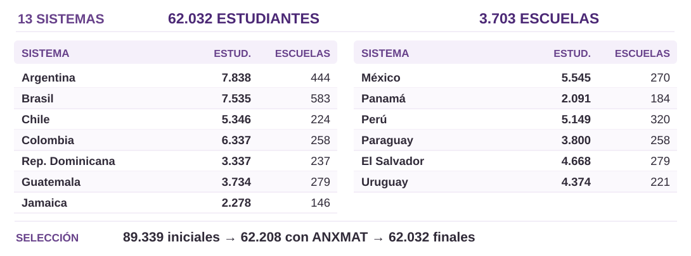

Proyecto de tesis, §4.2 y tabla 1 · Total descriptivo, no muestra regional única

<aside class="notes">La muestra final reúne 62.032 estudiantes de 3.703 escuelas en trece sistemas educativos. La tabla muestra por país la cantidad de estudiantes y escuelas. En los sistemas seleccionados había inicialmente 89.339 estudiantes; 62.208 disponen del índice de ansiedad matemática y 62.032 cumplen todos los criterios del análisis. La mayor disminución coincide con la disponibilidad del índice, sin poder atribuirla a una sola causa. Costa Rica se excluye por limitaciones de comparabilidad del ESCS. Cada sistema se modelará por separado; el total no es una muestra probabilística única de toda la región.</aside>

## Cinco medidas conectan estudiantes y escuelas {#slide_15}

MÉTODO / 03 · MEDIDAS · 0:30

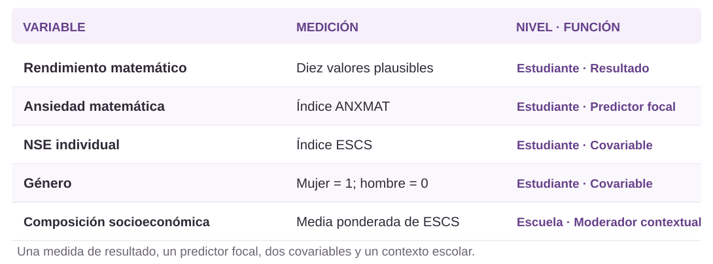

OCDE (2024); proyecto de tesis, §4.3 y tabla 2

<aside class="notes">Usaremos cinco medidas. El rendimiento matemático, mediante diez valores plausibles, es el resultado. La ansiedad matemática es el predictor focal; ESCS individual y género son covariables. La composición escolar es una medida contextual calculada mediante la media ponderada del ESCS de estudiantes muestreados de la misma escuela. Para comprender las medidas, primero revisaremos las experiencias que recoge ANXMAT.</aside>

## ANXMAT se construye con seis afirmaciones {#slide_16}

MÉTODO / 04 · ANSIEDAD MATEMÁTICA · 0:55

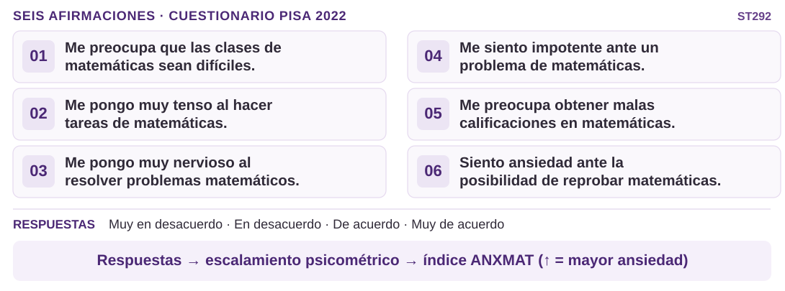

OCDE, cuestionario PISA 2022 ST292; informe técnico · Paráfrasis didácticas

<aside class="notes">ANXMAT no es una única pregunta: PISA 2022 incluye seis afirmaciones sobre preocupación por clases y calificaciones, tensión en tareas, nervios al resolver problemas, sensación de impotencia y ansiedad ante la posibilidad de reprobar. Aquí las seis están abreviadas en español como paráfrasis, no como traducción oficial chilena. El cuestionario utiliza cuatro categorías de acuerdo; la OCDE construye un índice mediante escalamiento psicométrico, no mediante una suma simple. Un valor mayor indica más ansiedad. El diseño de muestreo matricial dentro del constructo significa que no necesariamente cada estudiante recibió las seis afirmaciones. Ahora veremos cómo medimos la posición socioeconómica.</aside>

## ESCS combina recursos familiares y caracteriza la escuela {#slide_17}

MÉTODO / 05 · NIVEL SOCIOECONÓMICO · 0:50

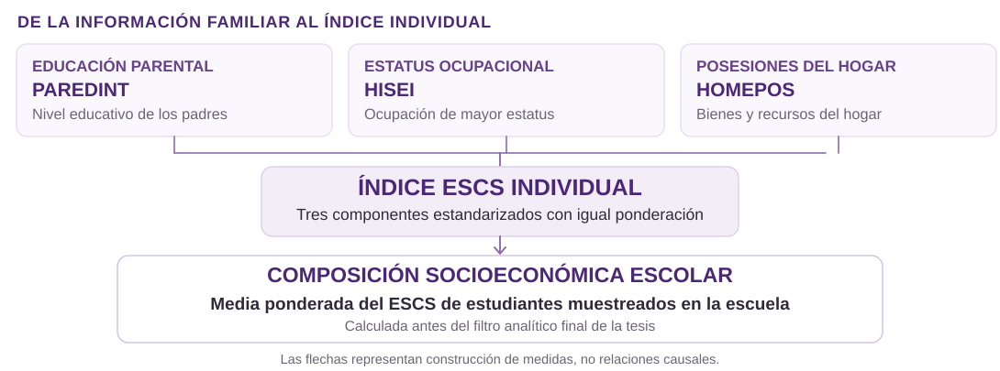

OCDE (2024), construcción de ESCS; proyecto de tesis, §4.3

<aside class="notes">Además de ANXMAT, medimos la posición socioeconómica individual con ESCS. PISA combina educación parental, estatus ocupacional de los padres y posesiones del hogar; son tres componentes estandarizados con igual ponderación, no solamente ingresos. A partir de ESCS calculamos una media ponderada por escuela, utilizando estudiantes muestreados con datos válidos antes del filtro analítico final. Así obtenemos la composición socioeconómica escolar, que es un perfil agregado y no una medida directa de recursos o calidad escolar. Estas variables pertenecen a estudiantes y establecimientos, de modo que debemos distinguir sus niveles.</aside>

## El centrado permite estudiar asociaciones dentro de las escuelas {#slide_18}

MÉTODO / 06 · MULTINIVEL Y CENTRADO · 0:50

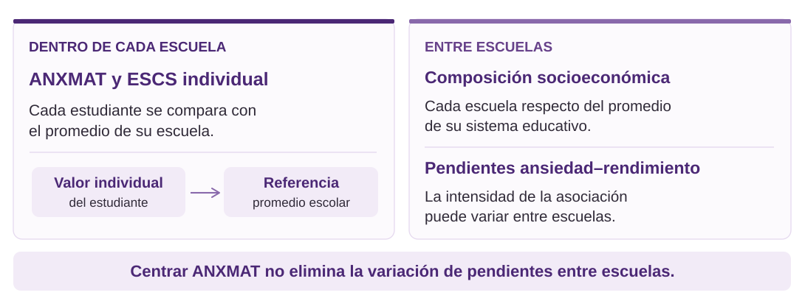

Enders y Tofighi (2007); Caro y Lenkeit (2012) · Proyecto de tesis, §4.4

<aside class="notes">Para estudiar la relación entre ansiedad y rendimiento dentro de cada escuela, centramos ANXMAT y ESCS individual respecto de sus promedios escolares. Así comparamos a cada estudiante con la referencia de su establecimiento. La composición escolar, en cambio, se expresa respecto del promedio del sistema. Esto no elimina las diferencias que buscamos estudiar: el modelo permite que la pendiente ansiedad–rendimiento varíe entre escuelas. Una precisión es que la ansiedad promedio escolar no entra como predictor contextual separado en el modelo principal; incorporarla sería una posible sensibilidad, todavía no ejecutada. Con esta distinción, veamos cómo M0–M5 contrasta las tres hipótesis.</aside>

## Seis modelos permiten contrastar tres preguntas {#slide_19}

MÉTODO / 07 · MODELOS M0–M5 · 0:55

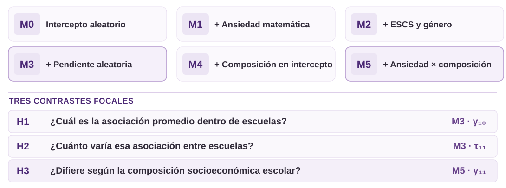

<aside class="notes">La estrategia incorpora componentes progresivamente. M0 considera un intercepto escolar aleatorio; M1 añade ansiedad, y M2 ajusta por ESCS individual y género. M3 permite que la pendiente de ansiedad cambie entre escuelas: allí contrastamos H1, la asociación promedio, mediante gamma diez, y H2, la varianza residual de pendientes, mediante tau once. M4 incorpora composición al intercepto; todavía no evalúa H3. M5 incorpora la interacción ansiedad por composición: gamma once permite contrastar H3, sin anticipar su signo. En M3 a M5 se incluyen interceptos y pendientes aleatorios con su covarianza. Así distinguimos promedio, heterogeneidad y moderación sin leer una ecuación.</aside>

## Cómo estimaremos, interpretaremos y compararemos {#slide_20}

MÉTODO / 08 · ESTIMACIÓN Y COMPARACIÓN · 0:55

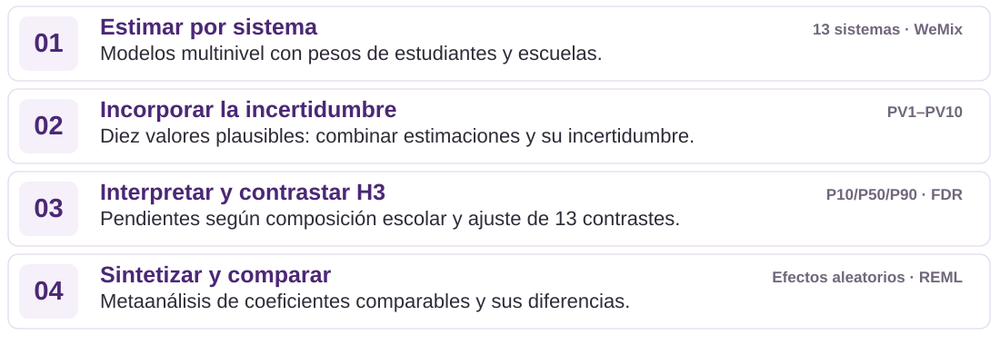

Bailey et al. (2023); OECD (2024b); Huang (2024); Benjamini y Hochberg (1995); Viechtbauer (2010)

<aside class="notes">Una vez definidos los modelos, falta explicar cómo estimaremos e interpretaremos sus resultados. Primero, analizaremos cada sistema por separado mediante modelos multinivel y ponderaciones de estudiantes y escuelas, porque PISA utiliza un diseño muestral complejo.

Segundo, ajustaremos los modelos con los diez valores plausibles, que no son pruebas distintas, y combinaremos las estimaciones y su incertidumbre.

Tercero, para H3 distinguiremos la interpretación y el contraste: mostraremos las pendientes en escuelas de distinta composición y corregiremos los trece contrastes nacionales por comparaciones múltiples.

Finalmente, sintetizaremos coeficientes comparables con un metaanálisis de efectos aleatorios. Así pasamos de las estimaciones nacionales a una comparación entre sistemas, manteniendo sus diferencias.</aside>

## Ansiedad matemática y rendimiento: una mirada contextual desde América Latina y el Caribe {#slide_21}

EL APORTE · 0:35

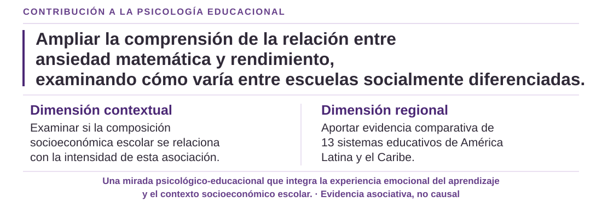

<aside class="notes">En definitiva, esta investigación busca contribuir a la Psicología Educacional ampliando nuestra comprensión de la relación entre ansiedad matemática y rendimiento. Nos interesa no solo conocer su asociación promedio, sino examinar cómo varía entre escuelas y qué papel puede desempeñar su composición socioeconómica, aportando evidencia comparativa desde trece sistemas educativos de América Latina y el Caribe.</aside>
